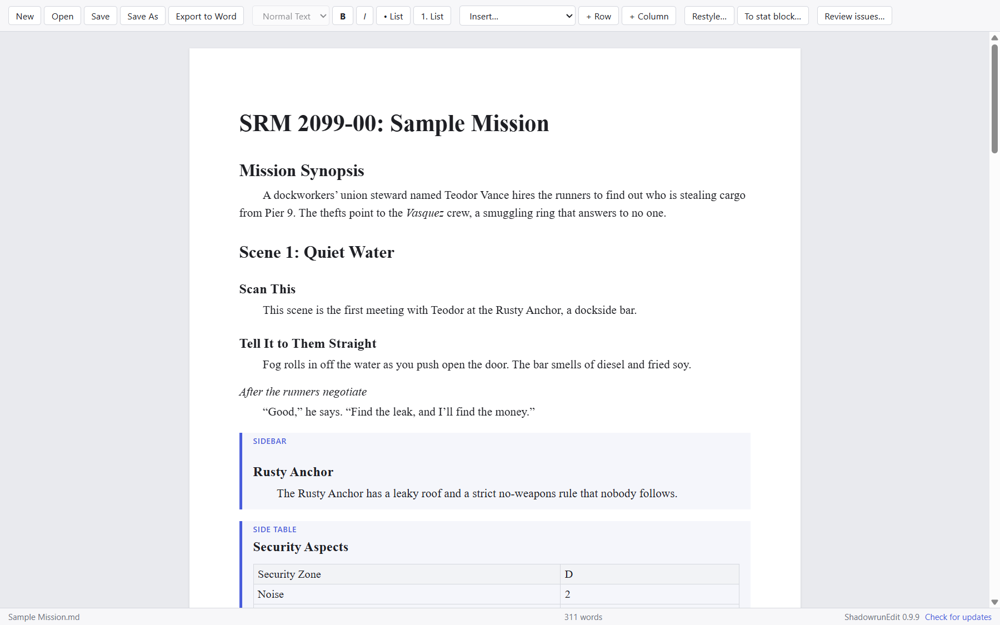
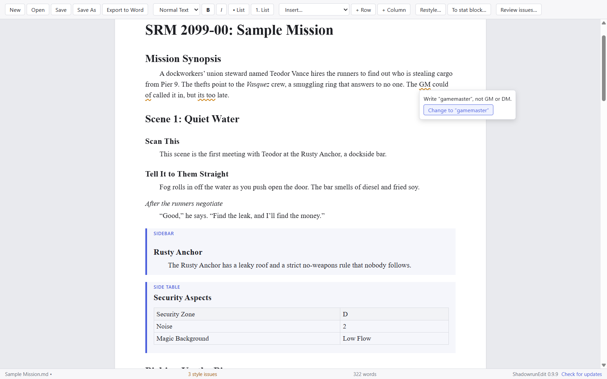
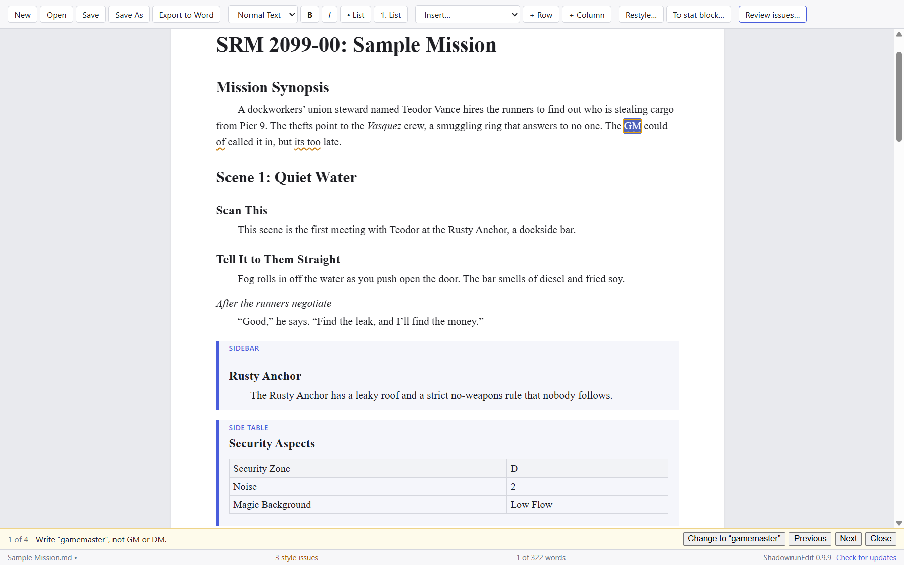
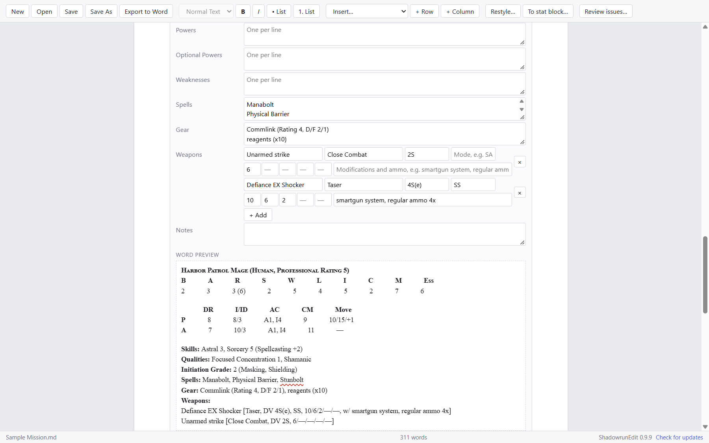
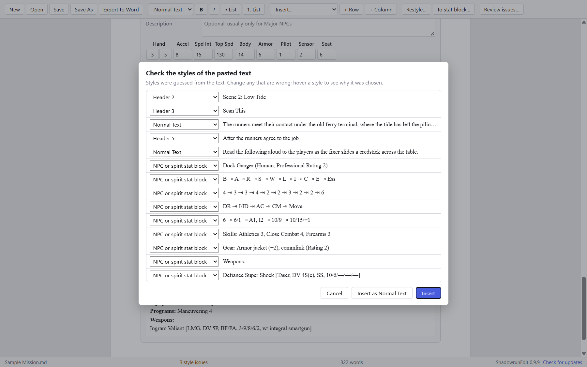
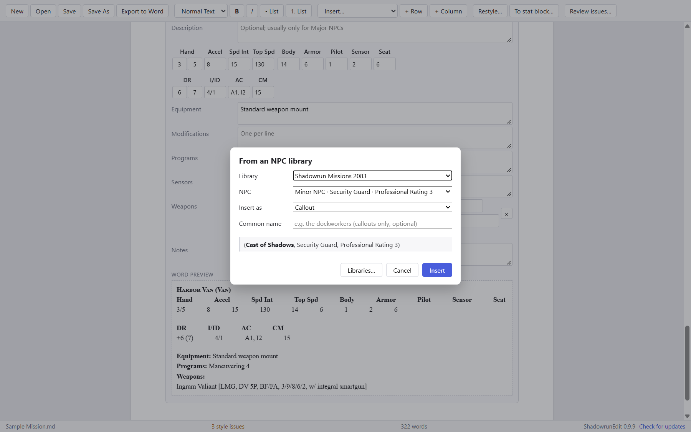

# ShadowrunEdit

**A word processor for Shadowrun freelance writers.** It keeps a manuscript inside the style guide as you write, fills in stat blocks for you, and exports a Word manuscript in the publisher's template.

For Windows, macOS, and Linux. Free. It works offline, and your files never leave your computer.

**[Download the latest version →](https://github.com/reverend0/ShadowrunEdit-releases/releases)**
Each release lists the file for your system and walks you through the one-time install warning.

## Write in the style guide, not around it

Only the publisher's paragraph styles exist: Header 1 to 5, Normal Text, tables, sidebars, side tables, layout notes, and Shadowtalk. There are no fonts, colors, or sizes to get wrong. Curly quotes, ’wares, ellipses, and dashes are set as you type.

As you write, ShadowrunEdit underlines anything the style guide, grammar, or spelling would flag, and most of it can be fixed in one click. It also checks that scene references, NPC callouts, and sidebars point to something that's really in the mission. A Shadowrun dictionary comes with it, and it learns the names your mission already uses.

**Review issues** (F8) steps through every issue in the document, one at a time.

## Stat blocks you fill in, not format

Pick NPC, decker, technomancer, critter, spirit, vehicle or drone, spell, or host, and fill in the form. The layout, labels, bold, and em dashes come from the stat block's definition, so every block of a type matches. Derived values (DR, Initiative, Condition Monitor, …) are calculated from the attributes, and ShadowrunEdit tells you when a typed value doesn't match the rules. The Word preview shows exactly what the export will be.

## Paste in a draft

Paste from Google Docs, Grammarly, or Word, and ShadowrunEdit suggests a style for each line: headings, read-aloud lines, tables, Shadowtalk, and whole stat blocks of every type. You check the suggestions, then insert.

## NPCs from the Bestiary

The Shadowrun Missions 2083 Bestiary comes built in, and you can import others. Insert an NPC as a full stat block, or as a callout that lists it in Cast of Shadows for you.

## Export to Word

**Export to Word** writes a manuscript in the publisher's template, ready to submit: the right paragraph styles, tab tables, layout notes, and page breaks before each scene. Documents themselves are saved as plain Markdown files, with autosave and crash recovery.

## Installing

Download the file for your system from [the releases](https://github.com/reverend0/ShadowrunEdit-releases/releases). The installers aren't code-signed (certificates cost about $170 a year, and ShadowrunEdit is free), so Windows and macOS warn you the first time you open it. Each release explains how to get past the warning, and how to check that your download is genuine. Once it's installed, updates are signed with the project's own key, and ShadowrunEdit offers them itself.

*The screenshots show a made-up sample mission.*
